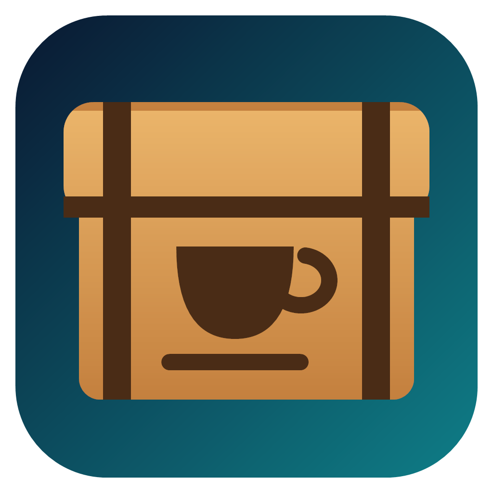
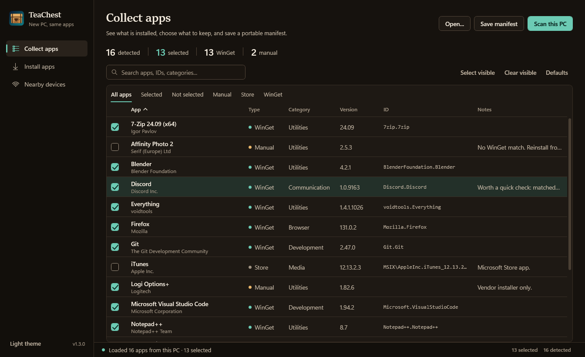

# AppMigrate



> **New PC, same apps.** Without the afternoon of digging through download pages trying to remember what you had installed.

AppMigrate looks at the PC you're leaving, works out which apps you actually use, and rebuilds that set on a fresh Windows install using WinGet and the Microsoft Store. It's a small native Windows app: no scripts, no accounts, no cloud, and nothing phoning home.

If both PCs are on the same network, you don't even need to carry a file between them. The new PC can find the old one, pair with it, and ask *"what have you got that I don't?"*



## What's new in 1.2

- **Nearby devices.** Pull the app list straight from your old PC over the local network, see what's missing, and install it. More on that [below](#nearby-devices).
- **Works on non-English Windows.** Earlier versions quietly lost the whole WinGet inventory on German, Japanese, Korean (and so on) systems. Fixed, and tested against WinGet's own translations.
- **Smarter "already installed" checks.** Having Python 3.11 no longer means Python 3.12 gets skipped.
- **Cancel is safe.** Stopping an install halfway still gives you a log and a report of what happened.
- **Restarts aren't failures.** Apps that installed fine but want a reboot are reported as exactly that.
- **Manifests are checked before they're trusted**, so a file from someone else can't sneak odd flags into WinGet.

The full list is in [CHANGELOG.md](CHANGELOG.md).

## Getting it

Grab the latest build from the [Releases page](https://github.com/grandprixgp/AppMigrate/releases/latest). It's a single self-contained `.exe`, so there's no .NET runtime to install first. Pick `win-x64` for most PCs, or `win-arm64` for Snapdragon / Copilot+ machines.

You'll need:

- Windows 10 (2004 or newer) or Windows 11
- WinGet, which comes with **App Installer**. Run `winget --version` to check. Most up-to-date Windows installs already have it.

The release isn't code-signed yet, so SmartScreen may give you a "Windows protected your PC" moment the first time. Click **More info → Run anyway**.

## How it works

There are three steps, and the middle one is optional if you use Nearby devices.

### 1. Collect: on the old PC

1. Open AppMigrate and click **Scan this PC**.
2. Watch the list fill in. The registry, Store apps, and WinGet are all scanned at the same time, so this usually takes a few seconds.
3. Search, filter, and tick the apps you want to keep. Runtimes, drivers, and things that ship with Windows start unticked, because you'd get those anyway.
4. Click **Save manifest**.

You get three files: `apps.json` (the one that matters), `apps.csv` for spreadsheet people, and `apps.md`, a tidy checklist you can read or print.

### 2. Move: get the list to the new PC

Either:

- copy `apps.json` across (USB stick, OneDrive, email to yourself, whatever's handy). AppMigrate picks up an `apps.json` sitting next to it automatically, or you can use **Load manifest...**, or
- skip the file and use [Nearby devices](#nearby-devices).

### 3. Install: on the new PC

1. Open the **Install apps** tab and click **Preview plan**.
2. Each app is marked **Install**, **Skip** (already here), or **Manual** (no automatic installer exists, so there's a note telling you where to get it).
3. Click **Install selected**, confirm, and go make a cup of tea.

A few knobs, if you need them:

| Option | What it does |
|---|---|
| **Force reinstall** | Installs even if the app is already there (`--force`) |
| **Allow interactive** | Lets installers show their own windows, for the stubborn ones that refuse to install silently |
| **Skip Store** | Leaves Microsoft Store apps as manual to-dos |
| **Match scope** | Installs per-user or machine-wide, matching how it was on the old PC |
| **Pin versions** | Asks for the exact version you had. Best effort: WinGet often only has the latest |

When it's done, these files are waiting next to the manifest:

```text
install-log-YYYYMMDD-HHmmss.txt       everything WinGet said, written as it happened
install-report-YYYYMMDD-HHmmss.json   per-app results, exit codes, and timings
manual-actions-YYYYMMDD-HHmmss.txt    your to-do list: manual installs, failures, and restarts
```

## Nearby devices

This is the fun bit. Instead of carrying a file around, you let the two PCs talk to each other directly.

1. **On the old PC:** open **Nearby devices** and click **Share this PC**. The first time, Windows asks once (a UAC prompt) to let AppMigrate through the firewall on private networks.
2. **On the new PC:** open **Nearby devices**. The old PC should appear within a few seconds. Select it and click **Connect and compare**.
3. **Both screens show the same 6-digit code.** If they match, click **Codes match, confirm** on the old PC.
4. The new PC shows you three lists: apps that are **missing here**, apps that are **already here**, and apps that are **only on this PC**.
5. Click **Install missing apps...** and you're back in the usual install flow, with everything ticked the way it was on the old PC.

Next time, the two PCs recognise each other and skip the code.

### If the old PC doesn't show up

- **Is the old PC's network set to Public?** Windows blocks incoming connections on Public networks, and AppMigrate will say so with a yellow warning and a button straight to the right setting. Home and office networks should be **Private**.
- **Guest Wi-Fi** often stops devices from seeing each other at all. Use the main network.
- **No luck finding it?** Type the address shown on the old PC into **Connect by address** on the new one.
- VPNs can get in the way, although Cloudflare WARP has worked fine in testing.

### Is it safe?

We've tried hard to make sure it is:

- **Read-only.** The only thing a paired PC can ask for is the app list. It can't install anything, run anything, or browse files.
- **Encrypted.** Everything goes over TLS between per-device certificates. Each certificate's key is stored in `%LOCALAPPDATA%\AppMigrate` and encrypted for your Windows account.
- **The code means something.** The 6 digits come from a commit-then-reveal exchange, so someone sitting in the middle of your network can't guess or force a matching code.
- **Local only.** Connections from outside your local network are refused, and the firewall rule covers only this exe, Private networks, and your local subnet.
- **Received lists are checked** before anything reaches WinGet: bad package IDs become manual items, and unexpected WinGet flags are stripped.
- **It switches itself off** after 30 minutes without requests.

To undo everything: delete `%LOCALAPPDATA%\AppMigrate` (that forgets the pairings) and, from an admin prompt, run

```powershell
netsh advfirewall firewall delete rule name="AppMigrate Nearby"
```

## What it won't do (yet)

AppMigrate moves *apps*, not your *stuff*. Specifically:

- **Data and settings don't come along:** documents, browser profiles, SSH keys, licence keys, app settings. OneDrive, your browser's sync, and a password manager cover most of this.
- **Drivers, firmware, and Windows features** aren't treated as apps. Windows Update handles the first, and the others are usually one checkbox away.
- **Steam, Epic, and GOG games** need re-downloading through their launchers. AppMigrate will happily reinstall the launchers themselves.
- **Portable apps** with no uninstall entry are invisible to the scan.
- **Store apps** may ask you to sign in.
- **Download-based installer entries** in a manifest are handled by the `cli/` scripts, not the app.

## Under the hood

### Scanning

`ScanService` runs three inventories at once and merges each one as soon as it finishes, which is why the table grows while you watch:

1. **Registry:** the uninstall keys in HKLM (64- and 32-bit) and HKCU.
2. **Store / AppX:** `PackageManager.FindPackagesForUser`, with proper display names and package families.
3. **WinGet:** a single `winget list`, read into package IDs, versions, and sources.

Apps that WinGet didn't already recognise are then matched by name, eight at a time. Exact names win, and loose matches are only accepted when there's exactly one candidate, so "Python 3.12" never quietly turns into Python 3.13. If WinGet cuts IDs short in its table output, AppMigrate fills them in from `winget export`.

### Every language WinGet speaks

WinGet's table output is translated, so AppMigrate doesn't look for words like "Name" or "Version". It finds the dashed line under the header and works out the columns from the spacing, counting double-width CJK characters properly. It's tested against WinGet's real headers in German, Japanese, Korean (the tricky one, since some titles contain spaces), and Traditional Chinese, and install results are read from WinGet's exit codes rather than its messages.

### Installing

Every install is a plain `winget install --id <id> --exact`. No scripts are generated or run. Results are judged by WinGet's documented return codes, so "installed, needs a restart", "a newer version is already here", and "the app is in use, close it and retry" each get their own clear message instead of a generic failure.

## Building from source

You'll need the [.NET 8 SDK](https://dotnet.microsoft.com/download/dotnet/8.0).

```powershell
dotnet build AppMigrate.sln -c Release
dotnet run --project .\src\AppMigrate
dotnet test AppMigrate.sln
```

To make a release build:

```powershell
.\build.ps1                         # self-contained win-x64 (what the Releases page ships)
.\build.ps1 -Runtime win-arm64      # same, for ARM64
.\build.ps1 -FrameworkDependent     # much smaller, but needs the .NET 8 Desktop Runtime
```

If PowerShell refuses to run the script, use `powershell -ExecutionPolicy Bypass -File .\build.ps1`. Output lands in `dist\` as both a folder and a zip.

CI (`.github/workflows/build.yml`) builds, runs the tests, and publishes a `win-x64` artifact on every push and pull request.

### Finding your way around

```text
src/AppMigrate/
  Models/            app records, the manifest format, classification rules
  Services/          registry, Store, WinGet, scanning, manifests, installing
  Services/Lan/      Nearby devices: discovery, pairing, the peer protocol, firewall
  ViewModels/        everything the UI binds to
  Themes/            dark and light palettes, control styles
  MainWindow.xaml    the UI itself
tests/AppMigrate.Tests/   parser, install, manifest, and networking tests
cli/                      the original PowerShell scripts, for automation
tools/Make-Icon.ps1       regenerates the icon set
build.ps1                 build and publish helper
```

## The PowerShell scripts

The `cli/` folder holds the original script-based workflow, still handy for unattended setups:

```cmd
cli\Export-Apps.cmd -Review
cli\Install-Apps.cmd -Plan
cli\Install-Apps.cmd
```

They read and write the same `apps.json` format as the app (the CLI can also read `apps.csv`). Unlike the app, they do use a process-scoped execution-policy bypass.

## Ideas for later

Things we'd love to get to. They're also sprinkled through the code as `TODO`s if you fancy picking one up:

- **More sources:** Scoop, Chocolatey, VS Code extensions, global npm/pipx/dotnet tools, WSL distros.
- **Settings over Nearby:** carry app settings (VS Code, Windows Terminal, Git config) along with the app list, opt-in per app.
- **WinGet Configuration export,** so `winget configure` can rebuild a PC from an AppMigrate scan, no AppMigrate required.
- **A "time machine":** quietly keep a dated manifest in OneDrive, because most migrations happen *after* a PC dies.
- **A headless mode** in the main exe, so the PowerShell scripts can retire.
- A proper details panel, live per-app status during installs, and a **Retry failed** button.

## Privacy

There's no telemetry, analytics, or account. AppMigrate talks to Windows, to WinGet (which talks to its package sources), and, only while you're using Nearby devices, to the other PC on your network. That's it.
